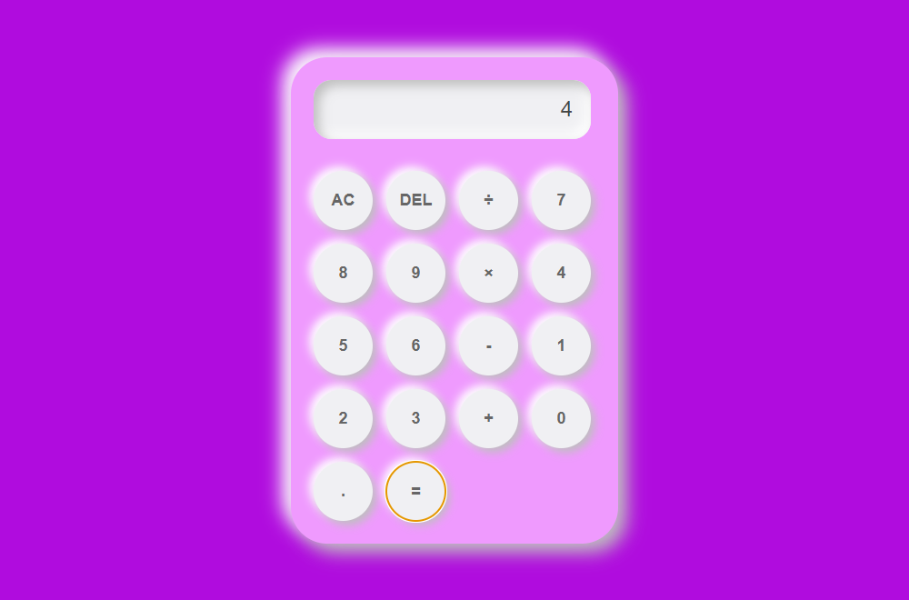
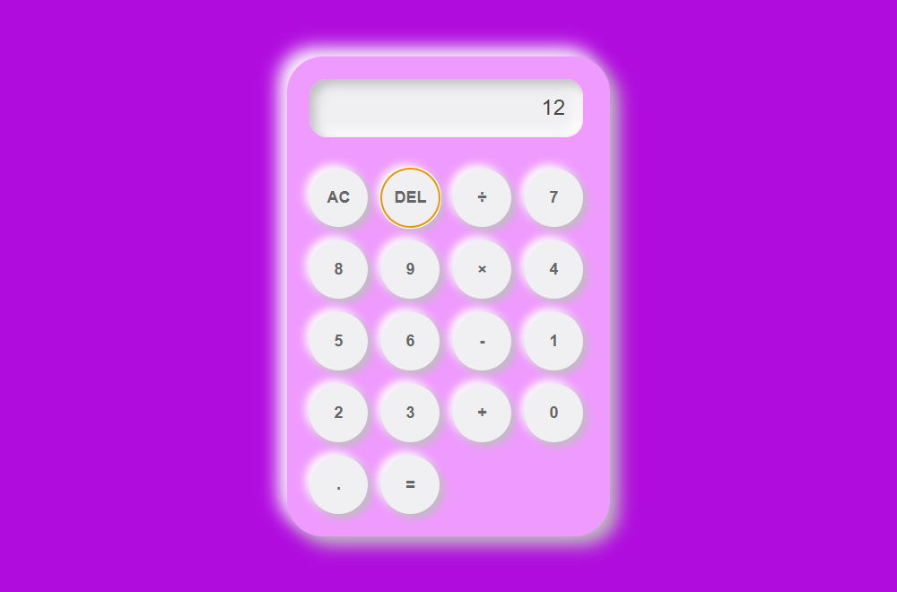

# INSTITUTO DE EDUCACIÓN SUPERIOR TECNOLÓGICO PÚBLICO

## SANTIAGO ANTÚNEZ DE MAYOLO

### "Ser excelentes"

---

**INFORME DE TRABAJO INDIVIDUAL**

**Título:** Implementación de pruebas automatizadas E2E con Cypress para las operaciones básicas de una calculadora web (Suma, Resta, Multiplicación, División y Borrado de dígito).

**Unidad didáctica:** Pruebas de Software / Aseguramiento de la Calidad

**Herramienta utilizada:** Cypress 14.5.4

**Estudiante:** _[Apellidos y Nombres]_

**Docente:** _[Nombre del docente]_

**Fecha:** _[dd/mm/aaaa]_

---

## 1. Introducción

La presente práctica tuvo como objetivo implementar un conjunto de pruebas automatizadas de
extremo a extremo (E2E) para la aplicación **Calculadora** desarrollada en HTML, CSS y JavaScript
que se viene trabajando en clase. Se implementó **una prueba por cada operación básica**:
**Suma**, **Resta**, **Multiplicación**, **División** y **Borrar un dígito (DEL)**, utilizando el
framework **Cypress**.

## 2. Marco teórico

**Cypress** es una herramienta de pruebas automatizadas de extremo a extremo basada en
JavaScript y ejecutada en el navegador. Se caracteriza por:

- Ejecutarse dentro del ciclo de vida del navegador, lo que le permite esperar de forma
  automática a que existan los elementos antes de interactuar con ellos.
- No requerir drivers externos (a diferencia de Selenium).
- Ofrecer comandos legibles como `cy.visit`, `cy.contains`, `cy.get().click()` y
  `cy.get().should()`.
- Generar automáticamente **capturas de pantalla (screenshots)** y **videos** de la ejecución,
  útiles como evidencia de las pruebas.

## 3. Aplicación bajo prueba

La calculadora está compuesta por:

| Elemento | Selector | Descripción |
|----------|----------|-------------|
| Pantalla de resultado | `#current-operand` | Muestra el valor actual. |
| Pantalla de operación | `#previous-operand` | Muestra el operando y el operador previos. |
| Botones numéricos | `button` con texto `0-9`, `.` | Ingresan dígitos mediante `appendNumber()`. |
| Botón AC | `button` con texto `AC` | Reinicia el estado con `clearDisplay()`. |
| Botón DEL | `button` con texto `DEL` | Borra el último dígito con `deleteNumber()`. |
| Operadores | `+`, `-`, `×`, `÷`, `=` | Invocan `chooseOperator()` y `compute()`. |

## 4. Diseño de los casos de prueba

| # | Operación | Caso de prueba | Entrada | Resultado esperado | Resultado obtenido |
|---|-----------|----------------|---------|--------------------|--------------------|
| 1 | Suma | Suma de dos números | 7 + 8 = | 15 | 15 ✅ |
| 2 | Resta | Resta de dos números | 9 - 4 = | 5 | 5 ✅ |
| 3 | Multiplicación | Producto de dos números | 6 × 7 = | 42 | 42 ✅ |
| 4 | División | División exacta | 8 ÷ 2 = | 4 | 4 ✅ |
| 5 | Borrar dígito | Borrar el último dígito | 123 → DEL | 12 | 12 ✅ |

## 5. Código de las pruebas (`cypress/e2e/calculadora.cy.js`)

```javascript
describe('Pruebas E2E de la Calculadora', () => {
  beforeEach(() => {
    // Abre la calculadora antes de cada prueba
    cy.visit('Calculadora.html');
  });

  afterEach(() => {
    // Captura automática del resultado de cada prueba
    cy.screenshot({ overwrite: true });
  });

  it('Suma: debe realizar 7 + 8 = 15', () => {
    cy.contains('button', '7').click();
    cy.contains('button', '+').click();
    cy.contains('button', '8').click();
    cy.contains('button', '=').click();

    cy.get('#current-operand').should('have.text', '15');
  });

  it('Resta: debe realizar 9 - 4 = 5', () => {
    cy.contains('button', '9').click();
    cy.contains('button', '-').click();
    cy.contains('button', '4').click();
    cy.contains('button', '=').click();

    cy.get('#current-operand').should('have.text', '5');
  });

  it('Multiplicación: debe realizar 6 × 7 = 42', () => {
    cy.contains('button', '6').click();
    cy.contains('button', '×').click();
    cy.contains('button', '7').click();
    cy.contains('button', '=').click();

    cy.get('#current-operand').should('have.text', '42');
  });

  it('División: debe realizar 8 ÷ 2 = 4', () => {
    cy.contains('button', '8').click();
    cy.contains('button', '÷').click();
    cy.contains('button', '2').click();
    cy.contains('button', '=').click();

    cy.get('#current-operand').should('have.text', '4');
  });

  it('Borrar un dígito: 123 con DEL debe quedar 12', () => {
    cy.contains('button', '1').click();
    cy.contains('button', '2').click();
    cy.contains('button', '3').click();
    cy.contains('button', 'DEL').click();

    cy.get('#current-operand').should('have.text', '12');
  });
});
```

## 6. Ejecución y evidencias

### 6.1 Comando de ejecución

```bash
npx cypress run --spec "cypress/e2e/calculadora.cy.js"
```

### 6.2 Resumen de la terminal

```text
  Pruebas E2E de la Calculadora
    √ Suma: debe realizar 7 + 8 = 15
    √ Resta: debe realizar 9 - 4 = 5
    √ Multiplicación: debe realizar 6 × 7 = 42
    √ División: debe realizar 8 ÷ 2 = 4
    √ Borrar un dígito: 123 con DEL debe quedar 12

  5 passing (3s)

  Tests:        5
  Passing:      5
  Failing:      0
  Screenshots:  5
  Video:        true
```

### 6.3 Capturas de pantalla de la ejecución y resultado

**Suma (7 + 8 = 15)**


**Resta (9 - 4 = 5)**


**Multiplicación (6 × 7 = 42)**


**División (8 ÷ 2 = 4)**



**Borrar un dígito (123 → 12)**



## 7. Resultados

Las **5 pruebas automatizadas** se ejecutaron de forma correcta, obteniendo **5 aprobadas,
0 fallidas, 0 pendientes y 0 omitidas**, con una duración aproximada de 3 segundos. Cypress
generó además 5 capturas de pantalla y un video (`cypress/videos/calculadora.cy.js.mp4`) como
evidencia adicional.

## 8. Conclusiones

1. Cypress permite automatizar pruebas E2E de una aplicación web de manera sencilla y con una
   sintaxis muy legible, facilitando la verificación automática de los resultados.
2. La estrategia de consultar elementos por su **texto visible** (`cy.contains('button', '7')`)
   resultó robusta, pues no depende de posiciones ni de identificadores frágiles.
3. Las operaciones **Suma**, **Resta**, **Multiplicación**, **División** y **Borrar un dígito
   (DEL)** funcionan correctamente en la calculadora.
4. El uso de `afterEach(() => cy.screenshot())` permitió documentar automáticamente la
   evidencia de cada prueba, lo que agiliza la elaboración del informe.

## 9. Referencias

- Documentación oficial de Cypress: https://docs.cypress.io
- Código de la aplicación: `Calculadora.html`
- Código de las pruebas: `cypress/e2e/calculadora.cy.js`
- Video de la ejecución: `cypress/videos/calculadora.cy.js.mp4`
